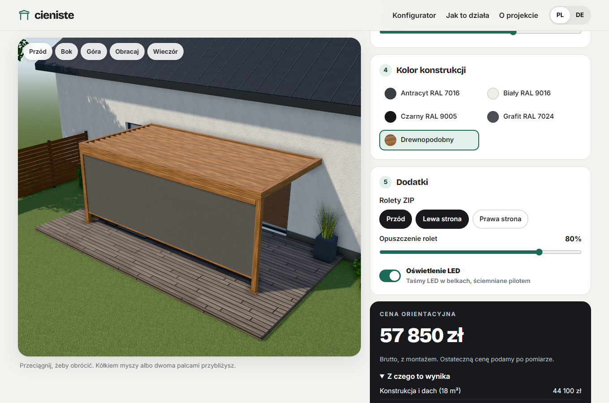
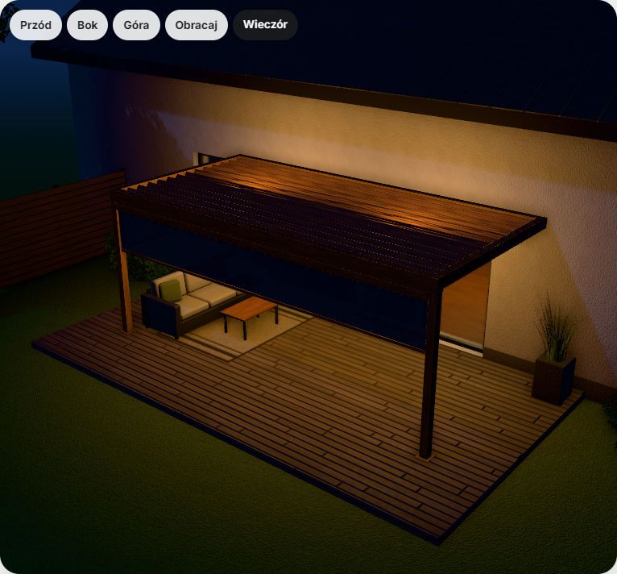
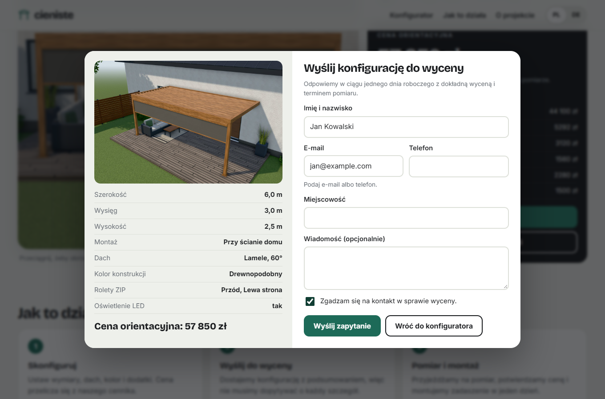

# Konfigurator pergoli 3D

Konfigurator produktu na wymiar z modelem 3D w przeglądarce. Klient ustawia wymiary, dach, kolor i dodatki, widzi pergolę na tarasie przy domu i od razu dostaje cenę. Gotową konfigurację wysyła do wyceny razem ze zdjęciem modelu albo zapisuje jako PDF.

To projekt demonstracyjny. Firma Cieniste, jej ceny i produkty są fikcyjne, a formularz niczego nie wysyła.

**Demo:** [kocpeel.github.io/konfigurator-pergoli](https://kocpeel.github.io/konfigurator-pergoli/)



| Wieczorem z oświetleniem LED | Zapytanie ze zdjęciem modelu |
|---|---|
|  |  |

## Co potrafi

- Model 3D budowany z parametrów: szerokość 3–7 m, wysięg 2–5 m, wysokość 2,2–3 m, montaż przy ścianie domu albo wolnostojący.
- Trzy rodzaje dachu: poliwęglan, szkło i obrotowe lamele z regulowanym kątem.
- Pięć kolorów konstrukcji, w tym drewnopodobny z teksturą.
- Rolety ZIP z trzech stron z regulacją opuszczenia i oświetlenie LED widoczne w trybie wieczornym.
- Widok z przodu, z boku i z góry, obracanie myszą albo palcem. Kamera dopasowuje się do wielkości pergoli i ekranu.
- Realistyczny wygląd bez pobierania plików graficznych: niebo z chmurami i jego odbicia, miękkie cienie, przyciemnienia w zakamarkach (ambient occlusion) i tekstury rysowane w kodzie. Wokół tarasu jest ogród z płotem, drzewami i krzewami, a przez okna osadzone w murze widać wnętrze domu, wieczorem oświetlone. Model rysuje się tylko wtedy, gdy coś się zmienia, więc nie obciąża telefonu.
- Cena liczona od razu z cennika, z rozbiciem na pozycje.
- Wersja polska z cenami w złotych i niemiecka w euro.
- Link do konfiguracji: ustawienia i język są zapisane w adresie strony, więc link można komuś wysłać.
- Formularz zapytania ze zdjęciem modelu i podsumowaniem. Po wysłaniu można pobrać jednostronicowe podsumowanie PDF.
- Widok na telefonie. Gdy przeglądarka nie obsługuje grafiki 3D, konfigurator i cena nadal działają.

## Technologie

| Warstwa | Narzędzia |
|---|---|
| Model 3D | Three.js (WebGL): materiały PBR, oświetlenie z mapy nieba, ambient occlusion (GTAO), tekstury generowane w kodzie, OrbitControls |
| Strona | HTML, CSS i JavaScript w modułach, bez frameworka |
| Budowanie | Własny skrypt w Node.js bez zależności |
| Testy | `node:test` dla cennika, linku i formularza, Playwright w Microsoft Edge dla całej strony |
| Hosting | GitHub Pages, publikacja przez GitHub Actions |

Three.js i czcionki są w repozytorium, więc strona nie pobiera niczego z zewnętrznych serwerów.

## Uruchomienie

Potrzebny jest Node.js 22 lub nowszy. Budowanie nie wymaga instalowania pakietów.

```powershell
npm run build
npm start
```

Strona działa wtedy pod adresem <http://localhost:4173>.

## Testy

```powershell
npm test
npm install
npm run e2e
```

- `npm test` sprawdza cenniki w złotych i euro, zapis konfiguracji w linku, poprawianie błędnych wartości z linku, formularz zapytania i komplet tłumaczeń.
- `npm run e2e` przechodzi w zainstalowanym Microsoft Edge cały konfigurator: model 3D, ceny, wersję niemiecką, link, formularz i wydruk. Zapisuje zrzuty ekranu w `docs/` i przykładowe podsumowanie `docs/podsumowanie.pdf`.

Na GitHubie testy uruchamiają się przy każdym wypchnięciu kodu, a strona publikuje się potem na GitHub Pages.

## Dostosowanie do innej firmy

- Ceny są w `src/assets/js/pricing.js`: dach za metr kwadratowy, dopłaty, rolety i LED za metr, montaż. Osobno w złotych i w euro.
- Zakresy wymiarów, rodzaje dachu, kolory i ustawienia domyślne są w `src/assets/js/config.js`.
- Teksty w obu językach są w `src/assets/js/i18n.js`.
- Model 3D jest w `src/assets/js/scene.js`, a tekstury w `src/assets/js/textures.js`. Profile, lamele i rolety powstają z wymiarów w kodzie. Producent, który ma modele z programu CAD, może je wczytać w formacie glTF.

## Struktura

```text
src/pages/          treść strony
src/partials/       nagłówek, stopka i pasek informacyjny
src/assets/js/      model 3D, cennik, konfiguracja, formularz i tłumaczenia
src/assets/css/     wygląd i wydruk
src/assets/vendor/  Three.js
scripts/            budowanie i lokalny serwer
tests/              testy logiki
e2e/                test w przeglądarce
docs/               zrzuty ekranu
```

## Licencje

Three.js jest na licencji MIT (`src/assets/vendor/three/LICENSE.txt`). Czcionki Bricolage Grotesque i Inter są na licencji SIL Open Font License (`src/assets/fonts/`).
